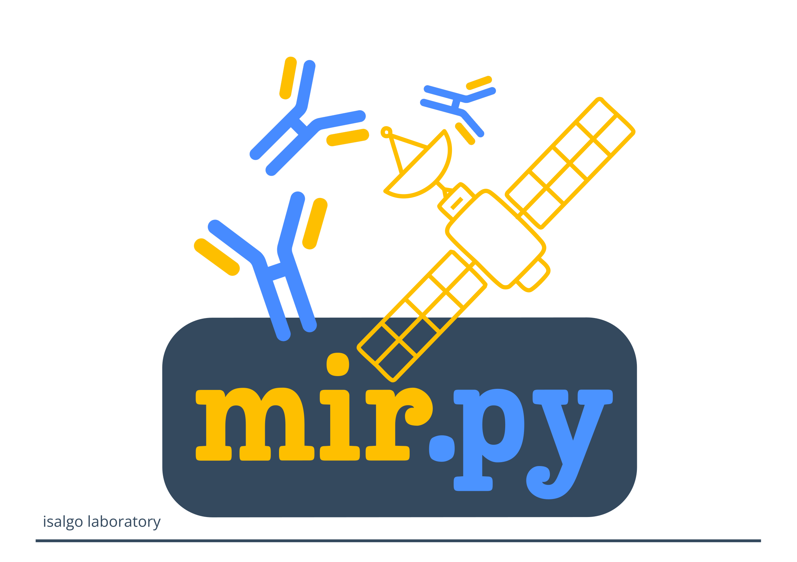
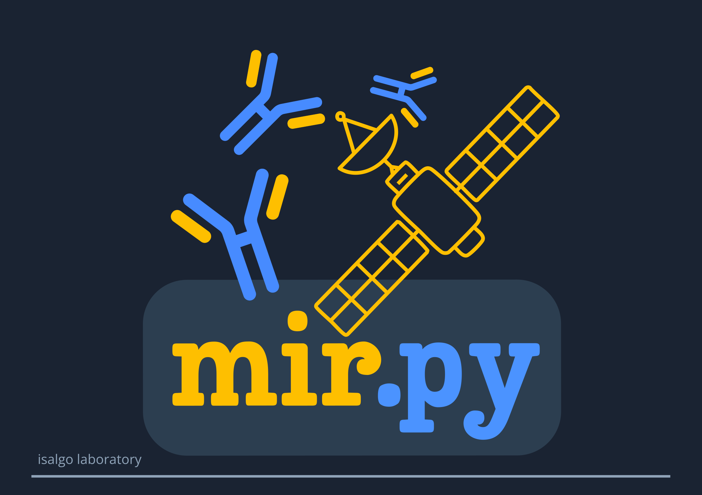
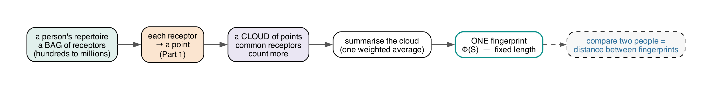

mirpy
=====

.. rst-class:: lead

   Turn T- and B-cell receptor repertoires into fixed-length numeric vectors you can cluster,
   visualise, and hand to a machine-learning model -- at the scale of one receptor, one repertoire,
   or a whole cohort.

mirpy implements **TCREMP**: each receptor is embedded by its alignment distances to a fixed set of
*prototype* sequences, so Euclidean distance in embedding space approximates pairwise alignment
distance. That turns a set of variable-length strings into a coordinate system, which is what every
downstream method actually needs.

PyPI package ``mirpy-lib``, import name ``mir``. Pure Python; the heavy lifting is reused from
`seqtree <https://github.com/antigenomics/seqtree>`_ and
`vdjtools <https://github.com/antigenomics/vdjtools>`_.

.. grid:: 1 2 2 2
   :gutter: 3
   :margin: 4 4 0 0

   .. grid-item-card:: Get started
      :link: getting-started
      :link-type: doc

      Install, embed your first receptors, cluster them, and compare two repertoires. Start here.

   .. grid-item-card:: Guides
      :link: usage
      :link-type: doc

      Guides by task: clonotype embedding, density and enrichment, repertoire embedding, the
      digital donor, explainable readouts, neural codecs.

   .. grid-item-card:: Sample RFF and PCA
      :link: embeddings
      :link-type: doc

      Export sample vectors, save a shared basis, and fit or reuse a sample rotation.

   .. grid-item-card:: Command reference
      :link: cli
      :link-type: doc

      Every command and every flag for the ``mir`` console script.

   .. grid-item-card:: Mathematical foundations
      :link: math
      :link-type: doc

      Why the prototype embedding is a coordinate system, what the repertoire vector knows, and
      what distance between two repertoires means.

   .. grid-item-card:: Worked examples
      :link: notebooks
      :link-type: doc

      Six runnable notebooks. Start with the signature pipeline: a folder of AIRR files to one
      table you can join with your metadata.

   .. grid-item-card:: Glossary
      :link: glossary
      :link-type: doc

      Every term this documentation uses. The immunology and signature vocabularies are defined
      once, in vdjtools' glossary, and linked from here.

Install
-------

.. code-block:: bash

   pip install mirpy-lib

Optional extras, each for one job:

.. code-block:: bash

   pip install "mirpy-lib[ann]"     # pynndescent: approximate neighbours at whole-repertoire scale
   pip install "mirpy-lib[ml]"      # torch: the neural codecs and the learned set encoder
   pip install "mirpy-lib[bench]"   # the benchmark harness and theory experiments

Three scales
------------

The three scales are the organising idea, and choosing the right one is most of the work:

.. list-table::
   :header-rows: 1
   :widths: 16 26 30 28

   * - Scale
     - One unit is
     - You get
     - Module
   * - Clonotype
     - one receptor
     - a point in prototype space
     - :mod:`mir.embedding`
   * - Repertoire
     - one sample from one donor
     - one fingerprint, ``Phi(S)``
     - :mod:`mir.repertoire`
   * - Cohort
     - many donors, several chains each
     - one comparable matrix
     - :mod:`mir.cohort`

Your first embedding
--------------------

.. tab-set::

   .. tab-item:: Python

      .. code-block:: python

         import mir                       # establish runtime limits first
         import polars as pl
         from mir.embedding.tcremp import TCREmp

         model = TCREmp.from_defaults("human", "TRB")     # per-chain preset: 2000 prototypes
         df = pl.DataFrame({
             "v_call":      ["TRBV10-3*01",   "TRBV20-1*01"],
             "j_call":      ["TRBJ2-7*01",    "TRBJ1-2*01"],
             "junction_aa": ["CASSIRSSYEQYF", "CSARVSGYYGYTF"],
         })
         X = model.embed(df)        # (2, 6000) float32 -- three distances per prototype

   .. tab-item:: Command line

      .. code-block:: bash

         mir embed clonotypes  samples/*.tsv  -o clonotypes.tsv
         mir embed repertoires cohort/*.tsv.gz -o sample_embeddings.tsv
         mir pca sample_embeddings.tsv --fit rotation.npz -o sample_pcs.tsv

Each clonotype row interleaves V, J and junction distances for each prototype. The
junction part comes from ``seqtree.gapblock``; the V and J parts are precomputed germline distances.

From a bag of receptors to one fingerprint
-------------------------------------------

         summarised into one fixed-length fingerprint Phi(S); two people are compared by the
         distance between their fingerprints.

A repertoire is an unordered multiset of receptors with clone sizes, so its vector has to be
invariant to order and robust to depth. ``Phi(S)`` sketches it as a weighted cloud of points in three
blocks -- a random-feature kernel mean, a coverage-standardised diversity profile, and a
second-moment block carrying co-occurrence structure:

:doc:`embeddings` covers sample RFF export, shared basis fitting, saved rotations
and the Python table API. :doc:`usage` covers MMD and motif witnesses.

.. important::

   Every sample in a cohort must be embedded through **one** prototype set and **one** basis, or the
   distances are not comparable. ``fit_repertoire_space`` fits that basis once, and every container
   refuses a prototype-hash mismatch rather than silently mixing two coordinate systems. Use
   ``unbiased=True`` whenever samples differ in depth: the biased estimator's self-term inflates
   low-diversity samples and can manufacture a signal.

Choose your path
----------------

.. list-table::
   :header-rows: 1
   :widths: 52 48

   * - You want to
     - Go to
   * - Embed receptors and cluster antigen-specific ones
     - :doc:`getting-started` | :doc:`usage`
   * - Choose a prototype count and a PCA dimension
     - :ref:`presets <which-prototypes>`
   * - Find enriched or antigen-driven neighbourhoods
     - :doc:`usage`
   * - Export sample RFF vectors and fit or reuse PCA
     - :doc:`embeddings`
   * - Compare whole repertoires rather than clonotypes
     - :doc:`usage`
   * - Get one fixed, named feature vector per sample
     - :doc:`signature`
   * - Name which part of a vector carries a signal
     - :doc:`channels`
   * - Understand why any of this is valid
     - :doc:`math`
   * - Look up a command or a function
     - :doc:`cli` | :doc:`api`
   * - Check what a term means
     - :doc:`glossary`

Citing
------

Cite this repository. The theory this implements is collected in :doc:`math`, and the derivations
and recorded benchmark numbers live in the companion analysis repository and
manuscript appendix.

ISALGO LAB Academic and Non-Commercial Research License v1.0.
See `LICENSE <https://github.com/antigenomics/mirpy/blob/master/LICENSE>`_.

The classical v1.x/v2 repertoire toolkit -- parsing, overlap, diversity,
TCRnet, GLIPH -- is frozen on the ``legacy-v2`` branch (``mirpy-lib`` 2.x); its functionality lives
on in `vdjtools <https://github.com/antigenomics/vdjtools>`_ and
`vdjmatch <https://github.com/antigenomics/vdjmatch>`_.

.. toctree::
   :hidden:
   :caption: Getting started
   :maxdepth: 2

   self
   getting-started
   glossary

.. toctree::
   :hidden:
   :caption: Guides
   :maxdepth: 2

   embeddings
   usage
   preprocessing
   signature

.. toctree::
   :hidden:
   :caption: Reference
   :maxdepth: 2

   cli
   api
   channels

.. toctree::
   :hidden:
   :caption: How it works
   :maxdepth: 2

   math

.. toctree::
   :hidden:
   :caption: Worked examples
   :maxdepth: 2

   notebooks
