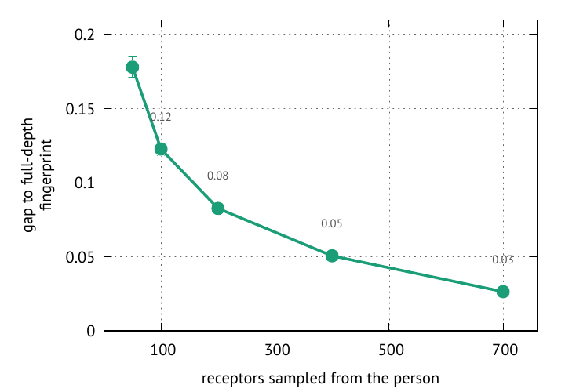

User guide
==========

One task per section, cheapest-to-run first. Every embedding operates on ``polars`` frames keyed by
the AIRR column names ``v_call`` / ``j_call`` / ``junction_aa`` (and ``duplicate_count`` for clone
sizes). Sections build on each other but each is self-contained.

Install & the data model
-------------------------

.. code-block:: bash

   pip install mirpy-lib            # core: import mir, and the `mir` CLI
   pip install "mirpy-lib[bench]"   # + benchmark harness (matplotlib, huggingface_hub, lifelines)
   pip install "mirpy-lib[ann]"     # + approximate-NN density backend (pynndescent)
   pip install "mirpy-lib[ml]"      # + neural codecs (torch)
   pip install "mirpy-lib[examples]"  # + marimo notebooks (marimo, matplotlib, umap-learn)

Requires vdjtools and seqtree, both installed at compatible versions for you; ``mir`` itself is a
pure-Python ``py3-none-any`` wheel. A clonotype table is a polars frame; clone sizes live in
``duplicate_count`` (repertoire-level embeddings weight by them):

.. code-block:: python

   import mir                            # establish runtime limits first
   import polars as pl

   sample = pl.DataFrame({
       "v_call":          ["TRBV10-3*01",   "TRBV20-1*01",   "TRBV28*01"],
       "j_call":          ["TRBJ2-7*01",    "TRBJ1-2*01",    "TRBJ2-1*01"],
       "junction_aa":     ["CASSIRSSYEQYF", "CSARVSGYYGYTF", "CASSLGQAYEQFF"],
       "duplicate_count": [120,             40,              12],
   })

To read a file in any format instead, use ``vdjtools.io.read`` (AIRR TSV, vdjtools, MiXCR,
immunoSEQ, parquet — the format is sniffed): ``sample = vdjtools.io.read("sample.tsv")``.

Clonotype embedding
-------------------

``TCREmp`` maps each clonotype to a fixed vector — its interleaved distances to a set of
prototype clonotypes, ordered V, J, junction for each prototype. Distance in this space approximates the
pairwise alignment distance (Theory T1).

.. code-block:: python

   from mir.embedding.tcremp import TCREmp

   model = TCREmp.from_defaults("human", "TRB", n_prototypes=1000)
   X = model.embed(sample)                  # (3 rows, 3×1000) float32, interleaved [v, j, junction]

   # paired chains: a dict of per-locus frames -> concatenated embedding
   from mir.embedding.tcremp import PairedTCREmp
   paired = PairedTCREmp.from_defaults("human", ("TRA", "TRB"))
   Xp = paired.embed({"TRA": tra_df, "TRB": trb_df})

.. _which-prototypes:

Which prototypes?
~~~~~~~~~~~~~~~~~

The prototype set *is* the coordinate system, so it is worth one paragraph. mirpy bundles **10 000
real receptors per chain** — a uniform random sample (fixed ``seed=42``) of unique, productive,
germline-resolvable clonotypes from arda-annotated real repertoires, for human TRA/TRB/TRG/TRD/
IGH/IGK/IGL and mouse TRA/TRB. Real, not model-generated: synthetic P_gen junctions have degenerate
lengths and embed measurably worse. Nothing is downloaded at import or build time; each set
carries its provenance in the ``manifest.json`` beside it, and
``src/mir/resources/prototypes/generate_prototypes.py`` rebuilds them.

``replicate=0`` — the first ``n`` rows — is **the** prototype set: what every preset, bundled codec
and published number uses. To ask *"is my result an artefact of which prototypes I drew?"*, take a
replicate. The file order is itself a uniform shuffle, so each disjoint block of ``n`` rows is an
independent draw from the same pool — ``n_replicates()`` of them, 10 at ``n=1000``, 5 at ``n=2000``:

.. code-block:: python

   from mir.embedding.prototypes import n_replicates, load_prototypes

   n_replicates("human", "TRB", 1000)                      # -> 10
   scores = [my_metric(TCREmp.from_defaults("human", "TRB", 1000, replicate=r).embed(sample))
             for r in range(10)]                           # spread = prototype-draw sensitivity

Usually it matters very little, and :func:`~mir.bench.theory.prototype_source_correlation` measures
it directly — it correlates the pairwise junction-distance geometry under two prototype sets, so
handing it two replicates answers the question at the geometry level. On 400 held-out human-TRB
queries, two independent draws agree at R = 0.922 (``n=100``), 0.971 (250), 0.990 (500),
**0.993 (1000 prototypes)**, 0.997 (2000): from ``n≈500`` up the geometry is effectively
draw-independent, and only below ``n≈250`` does the particular draw start to show.

.. warning::

   Each replicate is a **different coordinate system**. Distances within one are comparable,
   distances across two are not — the prototype hash covers the replicate index, so
   :class:`~mir.repertoire.RepertoireSpace`, :class:`~mir.cohort.DonorCohort` and the codec bundles
   all refuse to mix them. Compare *summary statistics* across replicates, never raw embeddings.
   Sweeping ``n_prototypes`` is a different question: those draws are **nested** (``r=0`` at
   ``n=500`` is a prefix of ``n=1000``), so a sweep answers "how many do I need", not "does it
   matter which".

Pick prototype counts / PCA dims from the per-chain presets, and denoise with PCA:

.. code-block:: python

   from mir.embedding.presets import get_preset
   from mir.embedding.pca import pca_denoise

   preset = get_preset("human", "TRB")      # n_prototypes, n_components (95% var), recon dims
   Xd = pca_denoise(X, n_components=preset.n_components)

**From the shell** — the ``mir embed clonotypes`` command does exactly this on a file:

.. code-block:: bash

   mir embed clonotypes cohort/*.tsv -o clonotypes.tsv
   #   input:  any format vdjtools.io reads; locus inferred (or pass --locus)
   #   output: one row per clonotype (id columns + e0…), TSV or (recommended for the wide raw
   #           embedding) streaming Parquet with the [parquet] extra. PCA is opt-in with ``--pca K --locus LOC``.

Clustering antigen-specific TCRs
--------------------------------

Antigen-specific receptors form tight clusters in the embedding. ``mir.bench`` clusters them and
scores per-antigen F1 / retention against known labels (e.g. a VDJdb dump):

.. code-block:: python

   from mir.bench.metrics import cluster, cluster_metrics

   labels = cluster(pca_denoise(X, n_components=50), method="dbscan")   # or "hdbscan" / "optics"
   # with epitope labels aligned to the rows:
   metrics = cluster_metrics(labels, epitopes)                         # {epitope: AntigenMetric}

DBSCAN (default) is tightest/purest; HDBSCAN trades precision for ~3× coverage on variable-density
data. See ``examples/quickstart.py`` for the end-to-end VDJdb example with a UMAP.

Density and background subtraction
----------------------------------

``mir.density`` finds antigen-driven convergent clusters by neighbour enrichment in the embedding
space (graph-free TCRNET/ALICE, Theory T6): ``E(z) = f_obs(z) / f_gen(z)`` estimated by an
adaptive-bandwidth balloon estimator with a Poisson/binomial test and BH q-values.

.. code-block:: python

   from mir.density import fit_density_space, neighbor_enrichment, enriched_mask, denoise_and_cluster

   # background = a biological control (TCRNET) or generate_background(...) (ALICE, P_gen)
   space, obs_emb, bg_emb = fit_density_space(model, obs_df, control_df, n_components=20)
   res  = neighbor_enrichment(obs_emb, bg_emb, test="binomial")   # exact multicore kdtree by default
   hits = obs_df.filter(enriched_mask(res, alpha=0.05))           # background-subtracted clones
   labels, mask = denoise_and_cluster(obs_emb, res)               # noise-filter + cluster the hits

Prefer a biological control (e.g. pre/post-vaccination) over the P_gen background — differential
enrichment cancels generic public convergence and isolates the antigen-specific response. Without
one of your own, pooled healthy-donor repertoires are a single ``hf_hub_download`` away
(read with ``vdjtools.io.read``; verify the chosen dataset card), and
:func:`~mir.density.generate_background` remains the P_gen fallback — pass ``source="arda"`` when
the observed data is arda-annotated (one allele namespace, no cascade fallback) and
``species="mouse"`` for mouse. The neighbour engine defaults to ``backend="kdtree"`` (exact,
multicore); at whole-repertoire scale pass ``backend="ann"`` (approximate, ``[ann]`` extra). See
``examples/density.py``.

Repertoire embedding Φ(S) + MMD
-------------------------------

``mir.repertoire`` embeds a whole repertoire — an order-invariant multiset of clonotypes with clone
sizes — into one fixed vector ``Φ(S)`` (kernel mean ‖ Hill diversity ‖ second moment), depth-robust
into the RNA-seq regime (Theory T7). Every sample in a cohort must share **one** basis, fit once:

.. code-block:: python

   from mir.repertoire import (sample_embedding,
                               mmd_matrix, hla_stratified_mmd, class_witness)

   from mir.embedding.table import fit_sample_spaces
   from vdjtools.cores import serial_kernels

   items = [(str(i), {"TRB": sample}) for i, sample in enumerate(samples)]
   with serial_kernels():
       space = fit_sample_spaces(items, {"TRB": model})["TRB"] # ONE basis, no pooled copy
   embs  = [sample_embedding(space, s) for s in samples]      # Φ(S); each .vector is the tensor
   D     = mmd_matrix(embs, unbiased=True)                    # pairwise MMD (unbiased when depth varies)

   # supervised motif finder: public clones separating two groups
   motifs = class_witness(space, pos_samples, neg_samples, candidates)

Read only a few hundred receptors and Φ is already close to the full-depth fingerprint — the
gap shrinks as ``n_eff^{-1/2}`` (Theory ``prop:kme``):

         ~0.18 at n=50 to ~0.03 at n=700 (real mir measurement, human TRB).

Use ``unbiased=True`` whenever samples differ in depth/diversity — the biased V-statistic's
``1/n_eff`` self-term otherwise inflates low-diversity samples and fakes a signal. For a
batch-confounded contrast, compare *within-batch* (residualise ``Φ`` on the batch indicator, see the
cohort section): a batch offset is first-order and cancels, while a batch-orthogonal signal (e.g.
HLA) survives.

For file cohorts, pass deferred readers rather than already-loaded frames. The
:doc:`embedding guide <embeddings>` covers bounded sample tables, CLI export,
basis reuse, control-cohort PCA and saved rotations.

Multi-chain digital donor (``mir.cohort``)
------------------------------------------

``mir.cohort`` fuses per-chain repertoire embeddings into one **digital donor** matrix — an
identity (kernel-mean) block plus diversity and coverage channels, per locus, merged by name. The
result is hash-verified (the prototypes *and* the fitted PCA must match) and serialisable, so a
held-out donor is projected through the same basis:

.. code-block:: python

   from mir.repertoire import fit_repertoire_spaces, correct_batch
   from mir.cohort import fit_donor_embeddings, residualize, cluster_samples

   spaces = fit_repertoire_spaces(models, cohort_frames)        # one RepertoireSpace per locus
   cohort = fit_donor_embeddings(spaces, donor_frames)          # DonorCohort{X, spec, ...}
   cohort.save("cohort.npz")                                    # carries every locus' prototype hash

   Xc  = residualize(cohort.X, batch)                           # first-order: subtract each batch mean
   Xc  = correct_batch(cohort.X, batch)                         # Harmony-like cluster-aware, when the
                                                                # batch is confounded with biology (T7 prop:batch)
   lab = cluster_samples(embs, unbiased=True)                   # MMD-cluster repertoires into states

``residualize`` removes a *global* batch offset; ``correct_batch`` removes it **per soft cluster**
(reducing to ``residualize`` at ``n_clusters=1``), so a batch confounded with a biological cluster is
corrected without erasing that biology.

Explainable channel readout (``mir.explain``)
---------------------------------------------

``Φ.vector`` is an anonymous concatenation, so "the classifier found something" has no noun.
``mir.explain`` attaches the names and asks which of them carries the signal. The scorer is yours —
the library never sees the labels, so the same call serves a cross-validated AUC or a Cox C-index
(scorers live in :mod:`mir.bench.eval`):

.. code-block:: python

   from mir.explain import stack_embeddings, channel_report
   from mir.bench.eval import cv_auc

   X, spec = stack_embeddings(embs)                     # X[i] is exactly embs[i].vector; names attached
   rep = channel_report(X, spec, lambda B: cv_auc(B, y)[0], base=0.5)
   rep.best                                             # -> 'second'  (the HLA imprint lives here)
   rep.frame()                                          # channel | n_columns | score | delta | rank

Leave-one-**in** (the default) asks whether a channel carries the signal *alone*; it is marginal, so
correlated channels both look important. ``mode="both"`` adds the conditional half — a channel with a
high ``delta`` but ``delta_out ≈ 0`` is **redundant**, its signal duplicated elsewhere. Assemble
heterogeneous channels (per-chain blocks merge by name) with :class:`~mir.explain.ChannelBuilder`,
and mark the kernel-mean blocks attributable so the readout can go one hop further, to the clones:

.. code-block:: python

   from mir.explain import ChannelBuilder, channel_drivers
   from mir.bench.eval import cv_cindex

   b = ChannelBuilder()
   for c in chains:
       b.add("identity", ident[c], attributable=True).add("diversity", hill[c])
   X, spec = b.add("coverage", log_reads).build()      # median-impute + z-score
   rep = channel_report(X, spec,
                        lambda B: cv_cindex(dur, evt, base=clin, block=B, n_pc=8),
                        base=cv_cindex(dur, evt, base=clin), mode="both")

   channel_drivers(rep, space=space, pos=pos, neg=neg, candidates=cands)

Only a kernel-mean channel has a clonotype pre-image. Asking which clones drive a Hill number is a
category error, and ``channel_drivers`` raises rather than answer it.

Survival / classification scorers (``mir.bench.eval``)
------------------------------------------------------

The scorers the readout consumes are plain functions of a feature block and your labels — usable on
their own:

.. code-block:: python

   from mir.bench.eval import cv_auc, cv_cindex, km_logrank

   mean, std = cv_auc(X, y)                             # repeated stratified-CV AUC (mean, std)
   c = cv_cindex(dur, evt, base=clin, block=X, n_pc=8)  # Cox C-index of clinical covariates + X
   c0 = cv_cindex(dur, evt, base=clin)                  # …the base to compare it against
   p = km_logrank(dur, evt, groups)                     # multivariate log-rank p-value

Needs the ``[bench]`` extra (scikit-learn is core; ``cv_cindex`` / ``km_logrank`` use ``lifelines``).
Unscorable convergence or no-pair folds warn; unexpected implementation errors propagate.

Neural codecs (``mir.ml``)
--------------------------

The optional ``mir.ml`` tier (``[ml]`` extra, torch) trains fast neural approximations of the
embedding: a forward encoder (sequence → code), an inverse decoder (code → sequence), a Pgen
regressor, and a unified codec; plus a learned repertoire set encoder. Device selection is
automatic (CUDA → MPS → CPU; override with ``device=`` or ``MIR_DEVICE``).

.. code-block:: python

   from mir.ml.bundle import CodecBundle

   bundle = CodecBundle.load("path/to/codec")
   encoder = bundle.forward_encoder()           # refuses a prototype-hash mismatch
   codes = encoder.code(sample["junction_aa"].to_list())     # CDR3 strings -> compact codes
   emb = encoder.encode(sample["junction_aa"].to_list())     # …or the full-space embedding

Training scripts and shipped bundles live in the companion analysis repo; this tier is experimental.

Performance and parallelism
---------------------------

mirpy is CPU-parallel by default and uses the GPU only in :mod:`mir.ml`. The settings that
control it, per hot path:

.. list-table::
   :header-rows: 1
   :widths: 22 24 16 38

   * - Stage
     - Knob
     - Default
     - Notes
   * - Embedding (junction distance)
     - ``TCREmp(..., threads=N)``
     - ``0``, allocated CPUs
     - The C++ ``seqtree.gapblock`` scorer. Releases the GIL; about 530 million pairs per second on
       16 cores. ``threads=1`` for a serial run.
   * - Density kNN and balloon estimator
     - ``neighbor_enrichment(..., backend=...)``
     - ``"kdtree"``, allocated CPUs
     - Exact and multithreaded, 5 to 9 times faster than the BallTree baseline. ``"ann"``
       (pynndescent) is about 30 times faster past 1e5 clones, with the **observed** side
       approximate and the **background** side always exact. ``"exact"`` is the single-core BallTree
       baseline, for reproducing older runs.
   * - Clustering
     - ``cluster(..., n_jobs=-1)``
     - ``0``, allocated CPUs
     - Resolved against the CPU allocation, then passed to the neighbour-search estimator.
       ``None`` selects one worker; negative counts are relative to the allocation.
   * - Signature cohort
     - ``rsig_cohort(..., n_jobs=N)`` / ``mir signature --jobs N``
     - ``1``, serial
     - ``0`` requests allocated CPUs. Workers share frozen panels and keep inner kernels serial.
   * - BLAS: PCA, RFF, matmul
     - shared runtime limits
     - 1 thread
     - Persistent BLAS pools stay serial; sample workers do not nest numerical pools.
   * - Neural codecs
     - ``pick_device()``, ``device=``, ``MIR_DEVICE``
     - CUDA, then MPS, then CPU
     - Every ``train_*`` entry point and every codec takes ``device=``; ``MIR_DEVICE=cuda:1`` pins
       the second GPU. The torch-free paths -- :mod:`mir.density`, :mod:`mir.repertoire` -- never
       touch the GPU.

As a rule: leave embedding at ``threads=0``, leave density on ``kdtree`` and switch to ``ann`` only
at whole-repertoire scale. See :ref:`mir-resource-limits` for explicit budgets.

Import ``mir`` before numerical libraries when starting a pipeline. Import-time
defaults keep persistent numerical pools serial, while caller-owned stages may
raise their active thread budget. The caller's ``OMP_THREAD_LIMIT`` is preserved;
an explicit hard cap still limits later OpenMP stages. Sample workers and native
batches share the allocation: finish the outer worker phase before starting a
multithreaded numerical stage.

.. note::

   The approximate backend is deliberately asymmetric. A recall below 1 undercounts the **observed**
   neighbourhood, which biases enrichment *down* and is therefore conservative. Undercounting the
   **background** would shrink the expected count and inflate both fold-change and significance,
   which is the one direction an enrichment test must never err in -- so the background occupancy is
   computed exactly whatever the backend.

Benchmark harness & reproducing the paper
------------------------------------------

``mir.bench`` provides the VDJdb clustering benchmark (F1 / retention / purity) and the reproduced
theory experiments (S1–S3, T5–T6, codec losslessness). The self-contained theory runs on bundled
data via ``examples/theory.py``; the full benchmark suite lives in the companion analysis repository.

.. code-block:: python

   from mir.bench.vdjdb import load_vdjdb, antigen_subset
   from mir.bench.metrics import cluster, cluster_metrics

   df = antigen_subset(load_vdjdb("vdjdb.slim.txt.gz"), chain="TRB", min_records=30)
   X = model.embed(df)                                   # df is already AIRR-named
   labels = cluster(pca_denoise(X, n_components=50))
   metrics = cluster_metrics(labels, df["epitope"])      # {epitope: AntigenMetric}

.. _mir-resource-limits:

CPU, density and container limits
---------------------------------

``neighbor_enrichment(..., threads=N)`` bounds KD-tree and ANN worker threads. Zero uses the
available CPU allocation; the exact BallTree reference backend is single-threaded. KD-tree
balloon queries retain only the kth distance, avoiding an observation-count by neighbor-count
output buffer. Both density backends count background occupancy exactly, including tied distances;
ANN approximation applies only to observation-neighbor recall.

Import ``mir`` before NumPy, Polars, or other numerical runtimes in a fresh worker.
The shared vdjtools runtime keeps persistent numerical pools serial and passes an
explicit CPU budget to sequence and neighbour kernels. ``threads=1`` selects serial
execution, ``threads=0`` selects the detected allocation, and a positive count must
fit that allocation. CPU affinity, scheduler allocation and visible cgroup quotas
(including parent quotas) all constrain the detected budget. A Kubernetes CPU request
alone is not a hard CPU limit.

Sample thread pools use one kernel thread per worker. Explicit requests that exceed
the allocation, or try to create an inner parallel kernel, raise an error. A Polars
pool initialized before the package cannot be resized: outer thread pools require a
fresh interpreter or ``workers=1``. Initialized BLAS pools are limited at runtime;
this does not destroy their idle OS threads.

The ANN backend keeps its Numba pool for the interpreter's lifetime and uses serial
KD-tree queries afterwards. Select its thread count on the first ANN call and retain
that count; a conflicting initialized pool raises an error. Neural training defaults
to one intra-op and one inter-op CPU thread; ``pick_device(threads=...)`` controls the
intra-op budget explicitly.

Weighted density reduces exact neighbor lists in bounded blocks rather than retaining
all edges at once. A dense graph still requires quadratic total work, but temporary
edge buffers hold at most one million candidates per block (or one complete
neighborhood if it exceeds that size). Counts and weighted sums retain their exact
per-row order. Sample pools share one interpreter and its frozen resources;
use an explicit ``n_jobs`` to bound concurrent sample buffers.
